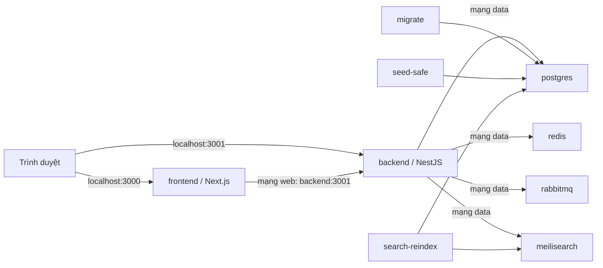

# Book Selling System

Hệ thống bán sách gồm frontend Next.js, API NestJS và các dịch vụ PostgreSQL, Redis, RabbitMQ, Meilisearch. Docker Compose khởi động toàn bộ hệ thống; máy chạy chỉ cần Docker Engine cùng Docker Compose (hoặc Docker Desktop trên Windows).

## Khởi chạy

Các lệnh dưới đây dùng Bash trên Linux hoặc Git Bash trên Windows, tại thư mục gốc của repository.

1. Sao chép cấu hình:

   ```bash
   cp .env.example .env
   ```

2. Mở `.env` và đặt **năm giá trị riêng**: `POSTGRES_PASSWORD`, `RABBITMQ_PASSWORD`, `MEILISEARCH_API_KEY`, `JWT_SECRET`, `SEED_DEFAULT_PASSWORD`. Dùng ký tự an toàn trong URL (ví dụ chuỗi hex) cho hai mật khẩu PostgreSQL và RabbitMQ. `.env` không được commit lên Git.
3. Khởi động:

   ```bash
   docker compose up --build -d
   docker compose ps --all
   ```

Compose đợi PostgreSQL sẵn sàng, chạy Prisma migration, thêm dữ liệu mẫu còn thiếu, lập chỉ mục sách, rồi mới khởi động API và frontend. Seed mặc định phục vụ **môi trường phát triển**. Không dùng cấu hình seed mẫu này cho production.

| Địa chỉ mặc định | Nội dung |
| --- | --- |
| `http://localhost:3000` | Giao diện bán sách |
| `http://localhost:3001/health` | Kiểm tra API và PostgreSQL/Redis/Meilisearch |
| `http://localhost:3001/api-docs` | Swagger UI |
| `http://localhost:3001/api-docs-json` | OpenAPI JSON |

Tài khoản mẫu: `customer-a@bookstore.example.com`, `customer-b@bookstore.example.com`, `staff@bookstore.example.com`. Mật khẩu của tài khoản **được tạo mới** là `SEED_DEFAULT_PASSWORD` trong `.env`. Seed không đổi mật khẩu tài khoản đã tồn tại.

## Kiến trúc container



`migrate`, `seed-safe` và `search-reindex` là tác vụ chạy một lần theo thứ tự. PostgreSQL, RabbitMQ và Meilisearch dùng named volumes; Redis là cache. Chỉ cổng frontend và backend được mở ra máy host. Trang Next.js gọi API qua `backend:3001` khi render trên server; trình duyệt dùng `NEXT_PUBLIC_API_URL`.

## Cấu hình cổng và URL

Giá trị mặc định nằm trong [mẫu môi trường](.env.example). Nếu đổi `BACKEND_PORT`, đặt `NEXT_PUBLIC_API_URL` thành URL mà **trình duyệt** truy cập được, rồi chạy lại `docker compose up --build -d` để build frontend với URL mới. Nếu đổi `FRONTEND_PORT` hoặc tên host, cập nhật `CORS_ORIGINS` cho đúng origin giao diện.

Các container chỉ dùng tên service nội bộ (`postgres`, `redis`, `rabbitmq`, `meilisearch`, `backend`), không dùng `localhost` để gọi nhau. File [backend/docker-compose.yml](backend/docker-compose.yml) vẫn hỗ trợ chạy riêng backend và sử dụng Compose project khác; dùng `compose.yaml` ở thư mục gốc khi muốn chạy toàn bộ hệ thống.

Các URL `localhost:3001` trong hướng dẫn dịch vụ dùng cổng mặc định. Nếu `BACKEND_PORT` đã đổi, thay `3001` bằng cổng trong `.env` khi chạy các lệnh từ máy host.

## Kiểm tra và vận hành

```bash
docker compose config --quiet
docker compose ps --all
curl -fsS http://localhost:3001/health
curl -fsS http://localhost:3000/
docker compose logs --tail=100 backend frontend
```

Trong `docker compose ps --all`, bốn dịch vụ dữ liệu, backend và frontend cần ở trạng thái `healthy`; ba tác vụ `migrate`, `seed-safe`, `search-reindex` cần kết thúc với mã 0. Lệnh thường dùng:

```bash
docker compose logs -f backend frontend
docker compose restart backend frontend
docker compose stop
docker compose up --build -d
```

Để kiểm tra dữ liệu bền vững, ghi lại số sách trước và sau `docker compose stop` rồi `docker compose up --build -d`:

```bash
docker compose exec -T postgres psql -U bookstore -d bookstore -c 'SELECT COUNT(*) FROM "Book";'
```

Thay `bookstore` nếu đã đổi `POSTGRES_USER` hoặc `POSTGRES_DB`. `docker compose down` vẫn giữ named volumes; **không dùng `docker compose down -v` nếu muốn giữ dữ liệu**.

## Xử lý lỗi thường gặp

| Hiện tượng | Cách kiểm tra |
| --- | --- |
| Compose báo thiếu biến môi trường | Tạo `.env` ở thư mục gốc và điền đủ năm giá trị bắt buộc; chạy `docker compose config --quiet`. |
| Cổng 3000/3001 đã được dùng | Đổi `FRONTEND_PORT`/`BACKEND_PORT` trong `.env`; cập nhật `NEXT_PUBLIC_API_URL` và `CORS_ORIGINS`, rồi build lại. |
| Frontend hiện lỗi tải sách | Kiểm tra `docker compose ps --all`, `docker compose logs --tail=100 frontend backend`, `NEXT_PUBLIC_API_URL` và `curl -fsS http://localhost:3001/books`. |
| Migration, seed hoặc reindex lỗi | Xem `docker compose logs migrate seed-safe search-reindex`; backend và frontend sẽ chờ các tác vụ hoàn thành. |
| Sửa `.env` nhưng frontend vẫn gọi URL cũ | Chạy `docker compose up --build -d`; `NEXT_PUBLIC_API_URL` được đưa vào bundle lúc build. |
| Đăng nhập tài khoản mẫu không được sau khi đổi mật khẩu seed | Seed không thay mật khẩu của user đã tồn tại; dùng mật khẩu đã tạo lần đầu hoặc tạo database phát triển mới. |

## Hướng dẫn từng dịch vụ

| Dịch vụ | Hướng dẫn |
| --- | --- |
| PostgreSQL | [Migration, dữ liệu mẫu và psql](backend/src/prisma/README.md) |
| Redis | [Cache, TTL và key](backend/src/redis/README.md) |
| RabbitMQ | [Sự kiện đơn hàng, outbox và DLQ](backend/src/infrastructure/rabbitmq/README.md) |
| Meilisearch | [Tìm sách và reindex](backend/src/search/README.md) |
| API | [Postman collection](backend/postman/Book-Selling-Backend.postman_collection.json), [quy ước response](backend/docs/API_RESPONSE.md) |

## Phát triển và kiểm thử mã nguồn

Docker Compose không yêu cầu cài Node.js trên máy host. Nếu sửa mã hoặc chạy test trực tiếp, dùng Node.js 22 và npm:

```bash
cd backend
npm ci
npm run prisma:generate
npm run lint
npm run build
npm test

cd ../frontend
npm ci
npm run build
```

`npm run test:e2e` ghi dữ liệu và cần database thử nghiệm tách biệt cùng `E2E_ISOLATED_DB=YES`; xem [phạm vi kiểm thử](backend/docs/evidence/runtime-verification-20261019.md). [AI Disclosure](backend/docs/AI_DISCLOSURE.md) ghi phạm vi AI hỗ trợ.
